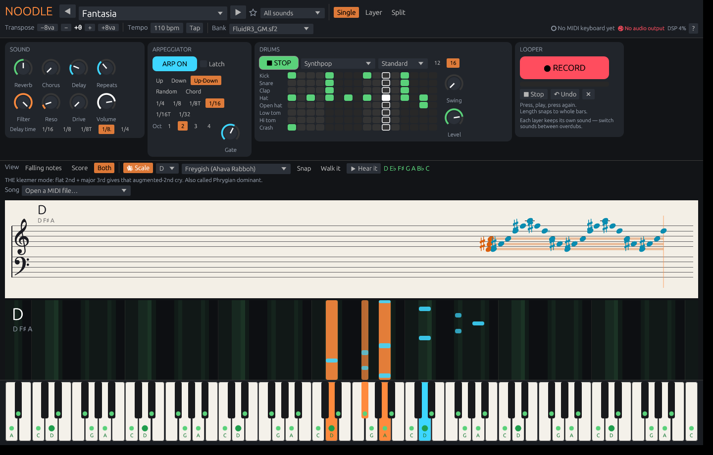

# Noodle

**Plug in a MIDI keyboard and play. Instantly.**

Noodle is a lightweight Linux/Windows instrument that behaves like switching on a digital piano: open it and it's already making sound. No projects, no routing, no plugin rummaging.



## What's in it

| | |
|---|---|
| **Instant play** | Every MIDI keyboard is picked up automatically, including ones you plug in later. No keyboard? Your computer keys `A W S E D F T G Y H U J K` play notes, and `Z`/`X` shift the octave. |
| **Sound bank** | Any SoundFont (`.sf2`): 128 GM sounds plus drum kits out of the box, browsable by family, with ★ favourites. Drop any `.sf2` on the window to add it. |
| **Layer / Split** | Two sounds stacked on every key, or split the keyboard at any note. |
| **Sound FX** | Reverb, chorus, tempo-synced ping-pong delay, resonant filter, drive. |
| **Arpeggiator** | Up / Down / Up-Down / Random / Chord, ¼ to 1/32 including triplets, 1–4 octaves, gate, latch. |
| **Drum machine** | 8-row step sequencer with 16 or 12 steps (4/4, 6/8, 3/4), swing, 8 kits, and presets including Synthpop, Power ballad, Bulgar (3+3+2), Hora, Reel and Jig. Drum pads on MIDI channel 10 play the kit live. |
| **Looper** | One button: record → close (snaps to whole bars) → overdub → done. Up to 6 layers, and **each layer keeps its own sound**, so you can loop bass, switch to strings and loop again. Undo removes the last layer. |
| **See your notes** | Falling-notes view, a scrolling grand staff with real notation (Bravura font, proper sharps and flats), or both. Live chord and interval naming. |
| **Scales** | Pick a root and scale. The keys light up with note names, and wrong notes flash red. **Walk it** steps you up and down the scale one note at a time, **Hear it** plays it, and **Snap** bends wrong notes to the nearest scale note. There are 66 searchable scales in these groups: everyday (major/minor/pentatonic/blues), church modes, Irish/Scottish, klezmer, jazz (bebop, altered, Lydian dominant, diminished…), harmonic-minor modes, Middle East/Balkans/Spain, East Asia, Indian thaats and symmetric scales. Each one is properly spelled on the staff. |
| **Songs** | Open any `.mid` (MuseScore: *File › Export › MIDI*). Notes fall onto the keys Synthesia-style. Pick **which part you play** and it goes silent and turns yellow. Speed runs from 25 to 150 %. **Wait for me** pauses the song until you hit your notes. |
| **Any keyboard size** | 25 / 32 / 37 / 49 / 61 / 76 / 88 keys on screen. A mini 88-key strip shows where your keys sit on a full piano, and **Follow** slides the view when you hit Oct +/−. |
| **MiniLab 3, 1:1** | Auto-detected. A panel laid out like its top surface: 8 knobs → Filter, Reso, Drive, Delay, Reverb, Repeats, Chorus, Arp gate; 4 faders → Volume, Layer, Drums, Song; main encoder browses sounds (Shift + turn = category); pads play drums; the bend/mod strips are shown live. Mapped controls never leak into the synth. |
| **Wind controllers** | EWI, Aerophone and other breath controllers are auto-detected. Breath (CC2, CC11, CC7 or aftertouch; it locks onto whichever arrives first) drives expression, with an adjustable response curve and an optional breath-opens-filter amount. The staff can show **written pitch** for B♭/E♭/F instruments and the tin whistle. |
| **🎮 Game mode** | Its own screen. Pick a scale drill (7 patterns × 5 rhythms, any tempo) or play a loaded tune or song as a game. The keys zoom to the notes you need, with a 3-2-1 count-in. Notes fall onto a glowing hit line and are judged Perfect (±45 ms), Great (±90 ms), Good (±140 ms), Miss or ✗ wrong note, with combo, multiplier, a live tally and progress. The results screen shows your grade, a breakdown and personal bests, with buttons for Again and Faster. Esc backs out one step at a time. |
| **🎶 Drone module** | **Bagpipes:** GHB, Scottish smallpipes, Border, uilleann, Northumbrian, Galician and Asturian gaita, Breton biniou, Bulgarian gaida. Synthesised drones (switch or retune each one) plus a chanter in just intonation against the drones that never drops out between notes. **Shruti box:** Sa–Pa / Sa–Ma / Sa–Ni drones locked to your key. **Harmonium:** any note plays its chord in your chosen key and mode. |
| **🎷 Real instruments** | A sample player for SFZ and Decent Sampler instruments, plus a **Get sounds** browser that downloads free recorded instruments one at a time (CC0 libraries: VSCO 2 CE, VCSL, the FreePats bagpipe, plus GeneralUser GS as a better default bank). Wind instruments play legato (no re-attack between connected notes), loop smoothly however long you hold, follow breath (CC2/CC11) and take vibrato from the mod wheel. Drop any .sfz or .dspreset (Pianobook's free instruments, for example) onto the window. |
| **🌆 Synthwave** | An analog-style polysynth: supersaw, Juno-style chorused PWM pads, Jupiter brass, gliding leads, outrun bass, arp plucks, strings and bells — plus an 80s drum kit with metallic hats and a gated-reverb snare. |
| **🥁 Live drums** | Eight pattern slots (A–H) you switch between live (changes land on the next bar), a FILL button, row mutes for drops, and an arrangement chain (A×8 → B×8 with a fill → …) that plays your song's structure. Kits: SoundFont kits plus NES, Game Boy, C64, Genesis, Amiga and 80s synthwave. |
| **▦ Panels** | Show or hide each panel. Fingering follows your sound: pick a flute, sax, recorder, whistle or bagpipe and its chart appears; pick a piano and it gets out of the way. |
| **👾 Chiptune** | NES (pulse duties, the 4-bit triangle, noise; real 2A03 pitch steps), Game Boy (pulse, wave channel), C64 SID (saw, PWM, resonant filter), Sega Genesis (4-operator FM, YM2612 algorithms, 9-bit DAC grit), Master System, Amiga (8-bit, hard-panned, A500 filter) and SNES (echo). Each chip keeps its real voice count; hold more notes and it arpeggiates the chord at frame rate, like the old composers did. |
| **🕐 Metronome** | Click on every beat, accent on the bar (2/4 to 12/4), with a blinking light. |
| **🎻 Tunes** | Browse The Session's 11,000+ Irish, Scottish and English trad tunes: search by any name a tune goes by, filter by type, sort by popularity, pick any setting. Or paste or drop in any ABC tune (klezmer, balfolk, Swedish polskas…). A loaded tune plays as a song, with falling notes, wait mode, game mode and fingering, and Noodle sets the Scale and the drones to its key. The Session data is downloaded on request, credited, and refreshed weekly. |
| **🪈 Fingering** | Draws the instrument and covers the holes or presses the keys for the note you're playing, with the next note shown faded beside it, and a whole-chart view. Charts: Great Highland chanter, Scottish smallpipes, Leicestershire smallpipes (covered/open), uilleann, soprano recorder, sopilka, tin whistle (any key, including low D), Boehm flute and saxophone (alto, tenor, soprano, baritone or written pitch). Every chart is transcribed from a real fingering chart, not worked out from theory. |
| **Remembers** | Opens exactly how you left it. |

## Keys

| Key | Does |
|---|---|
| `A W S E D F T G Y H U J K O L P ;` | play |
| `Z` / `X` | octave down / up |
| `←` / `→` | previous / next sound |
| `Space` | drums play / stop |
| `Enter` | looper button |
| `Backspace` | undo last loop layer |
| `Esc` | panic (all notes off) |
| `V` | cycle view: falling notes / score / both |
| `F2` | hide / show the panels |
| `F1` | help |

## Install

**Linux**: needs ALSA (every distro has it) and a sound bank:

```sh
sudo pacman -S soundfont-fluid          # Arch / CachyOS
sudo apt install fluid-soundfont-gm     # Debian / Ubuntu
sudo dnf install fluid-soundfont-gm     # Fedora
./install.sh                            # → ~/.local/bin/noodle + app menu entry
```

**Windows**: unzip and run `noodle.exe`. The FluidR3 GM bank is bundled in `soundfonts/`.

Extra sound banks go in `~/.local/share/noodle/soundfonts` (Windows: `%APPDATA%\noodle\soundfonts`), and songs go in `…/noodle/songs`. Noodle also looks in your Music, Downloads and MuseScore score folders.

## Build

```sh
sudo pacman -S alsa-lib      # or libasound2-dev / alsa-lib-devel
cargo build --release
./target/release/noodle --render-test test.wav   # headless self-test, writes a WAV
```

## Roadmap

- **SFZ instruments**: the open sampler format. ConvertWithMoss turns Ableton Sampler (.adv/.adg), Kontakt, EXS and more into SFZ
- **Plugin hosting** (CLAP / VST3 / LV2): play Omnisphere, SWAM etc. inside Noodle (Windows natively; Linux via yabridge)
- **Modelled wind instruments** built for breath controllers (sax, clarinet, flute, whistle)
- MIDI-learn for any controller
- EWI and Aerophone key view: the horn drawn on screen with its keys lit from the notes you play
- Clarinet and oboe fingering

- Noodle's own synth engine (Omnisphere-inspired: layered oscillators, an XY "orb" for morphing)
- MusicXML / MuseScore import
- Audio looper (record a real instrument through your interface)
- MIDI-learn for every knob, user "scenes"
- Record your playing to MIDI / WAV
- Latency and device picker, ASIO on Windows

## Licence

GPL-3.0-or-later © 2026 Fancy Butler.
Bravura music font © Steinberg Media Technologies, SIL Open Font License (see `assets/Bravura-OFL.txt`).
